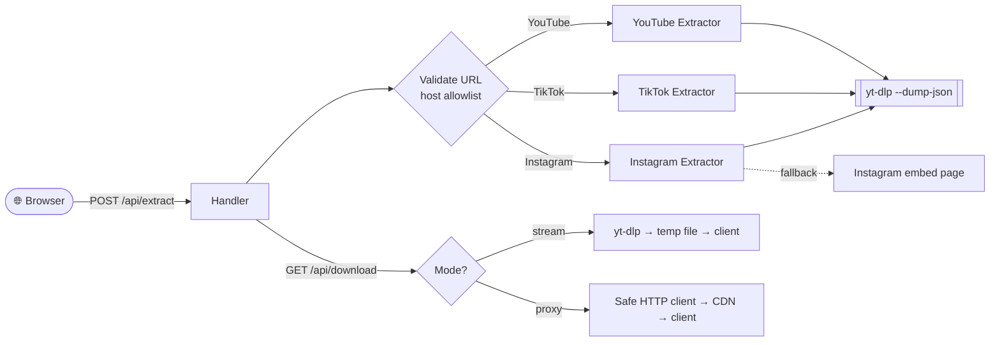

<div align="center">

# ⚡Fetchly

**Download videos, audio and photos from YouTube, TikTok and Instagram.**
Paste a link, pick a quality, done.

<br>


<br>

[Features](#-features) •
[Quick Start](#-quick-start) •
[API](#-api) •
[Configuration](#%EF%B8%8F-configuration) •
[Architecture](#-architecture)

</div>

---

## ✨ Features

| Platform | What you can download |
|---|---|
| **YouTube** | 1080p / 720p / 480p video (H.264 + AAC, plays on any phone) and M4A audio |
| **TikTok** | Highest-resolution MP4 and the original audio |
| **Instagram** | Reels, single photos, and carousels (every slide, photo or video) |


---

## 🚀 Quick Start

### Prerequisites

| Requirement | Notes |
|---|---|
| [Go](https://go.dev/dl/) 1.27+ | To build and run the server |
| [yt-dlp](https://github.com/yt-dlp/yt-dlp) | The extraction engine. Must be on your `PATH` (or `yt-dlp.exe` in the project folder on Windows) |
| [ffmpeg](https://ffmpeg.org/) | Merges YouTube video and audio streams |
| [deno](https://deno.com/) *(optional)* | Only needed if you use `cookies.txt` |

### Run it

```bash
# 1. Get the code
git clone https://github.com/Liiff/fetchly.git
cd fetchly

# 2. Start the server
go run ./cmd/server
```

Open **http://localhost:8080**, paste a link, and hit **EXTRACT**.

> Run with `GIN_MODE=debug` during development for more verbose logs.

<details>
<summary><b>Windows notes</b></summary>

<br>

Place these binaries in the project root (they are already in `.gitignore`, so they won't be committed):

```
yt-dlp.exe
ffmpeg.exe
ffprobe.exe
deno.exe        # only if you use cookies.txt
```

Fetchly looks in the project folder first, then falls back to the system `PATH`.

</details>

<details>
<summary><b>Using cookies (age-restricted or login-only content)</b></summary>

<br>

Export your browser cookies in Netscape format and save them as `cookies.txt` in the project root. When this file exists, Fetchly automatically adds `--cookies` and the `deno` JS runtime to every yt-dlp call.

> ⚠️ `cookies.txt` contains your logged-in session. Never commit it, and don't use your main personal account on a public server.

</details>

---

## 🔌 API

### `POST /api/extract`

Fetches metadata and the list of download options for a URL.

```bash
curl -X POST http://localhost:8080/api/extract \
  -H "Content-Type: application/json" \
  -d '{"url": "https://www.youtube.com/watch?v=dQw4w9WgXcQ"}'
```

<details>
<summary><b>Example response</b></summary>

```json
{
  "status": "success",
  "platform": "youtube",
  "media_type": "video",
  "title": "Video title",
  "thumbnail": "https://i.ytimg.com/vi/.../maxresdefault.jpg",
  "duration": "03:33",
  "formats": [
    {
      "format_id": "1080p",
      "quality": "1080p (Full HD)",
      "ext": "mp4",
      "is_stream": true,
      "download_url": "/api/download?url=https%3A%2F%2F...&format_id=1080p"
    }
  ]
}
```

</details>

`media_type` is one of `video`, `image` or `carousel`.
When `is_stream` is `true`, the server processes the file through yt-dlp. When it is `false`, the file is fetched from the source CDN through Fetchly's proxy.

### `GET /api/download`

| Parameter | Mode | Description |
|---|---|---|
| `url` | both | Stream: the YouTube page URL. Proxy: the file URL on an allowed CDN |
| `format_id` | stream | One of `1080p`, `720p`, `480p`, `audio` |
| `proxy` | proxy | Set to `1` to relay a file from a CDN |
| `filename` | optional | Suggested filename. The server sanitizes it |

> You normally don't need to build this URL yourself. Use the `download_url` value from the `/api/extract` response as-is.

### `GET /api/health`

```json
{ "status": "ok", "service": "fetchly-go" }
```

---

## ⚙️ Configuration

All variables are optional.

| Variable | Default | Purpose |
|---|---|---|
| `PORT` | `8080` | Server port |
| `GIN_MODE` | `release` | Set to `debug` for development |
| `TRUSTED_PROXIES` | *(empty)* | Comma-separated IPs/CIDRs of your reverse proxy |
| `EXTRA_CDN_HOSTS` | *(empty)* | Comma-separated extra CDN domains allowed through the proxy |
| `MAX_EXTRACT` | `4` | Concurrent yt-dlp metadata extractions |
| `MAX_STREAM` | `2` | Concurrent yt-dlp downloads |
| `MAX_PROXY` | `20` | Concurrent CDN proxy transfers |

```bash
# Example: behind nginx, with a higher download limit
PORT=9000 TRUSTED_PROXIES=127.0.0.1 MAX_STREAM=4 go run ./cmd/server
```

> ⚠️ **If you run behind a reverse proxy (nginx, Cloudflare, etc.) you must set `TRUSTED_PROXIES`.** Otherwise every visitor appears to come from one IP, and the rate limiter will block them all together.

Built-in rate limits per IP: `/api/extract` allows 20 requests per minute (burst 5), `/api/download` allows 30 per minute (burst 10).

---

## 🧩 Architecture



### Project structure

```
fetchly/
├── cmd/server/          # Entry point: routing, middleware, graceful shutdown
├── internal/
│   ├── handler/         # HTTP handlers (extract & download)
│   ├── extractor/       # One file per platform + the Extractor interface
│   ├── streamer/        # Downloads via yt-dlp and the CDN proxy
│   ├── validate/        # Platform URL, CDN URL and filename validation
│   ├── safehttp/        # Anti-SSRF HTTP client (blocks private IPs)
│   ├── limit/           # Concurrency semaphore + per-IP rate limiter
│   ├── ytdlp/           # Shared yt-dlp binary lookup and arguments
│   └── model/           # JSON request/response types
└── web/
    └── index.html       # User interface
```

---


## ⚖️ Disclaimer

Fetchly is built for learning and personal use. Downloading content from YouTube, TikTok and Instagram may violate each platform's terms of service, and downloaded content remains protected by its owner's copyright. Make sure you have the right or permission to download any content, and you are solely responsible for how you use this tool. If you expose this service publicly, also consider the legal risks and the possibility of being blocked by the platforms.

---
